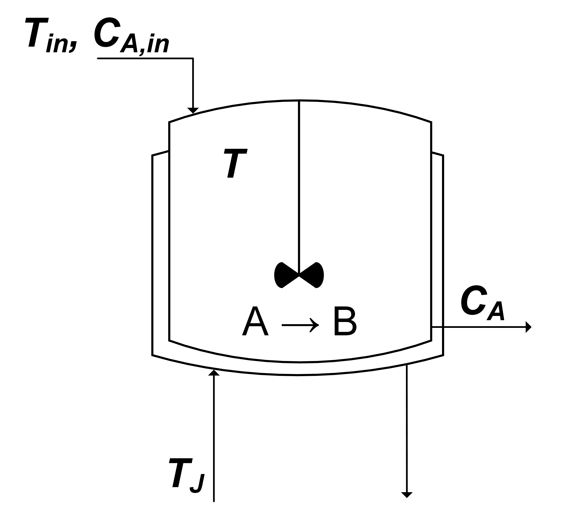

<script type="text/javascript"
  src="https://cdnjs.cloudflare.com/ajax/libs/mathjax/2.7.0/MathJax.js?config=TeX-AMS_CHTML">
</script>
<script type="text/x-mathjax-config">
  MathJax.Hub.Config({
    tex2jax: {
      inlineMath: [['$','$'], ['\\(','\\)']],
      processEscapes: true},
      jax: ["input/TeX","input/MathML","input/AsciiMath","output/CommonHTML"],
      extensions: ["tex2jax.js","mml2jax.js","asciimath2jax.js","MathMenu.js","MathZoom.js","AssistiveMML.js", "[Contrib]/a11y/accessibility-menu.js"],
      TeX: {
      extensions: ["AMSmath.js","AMSsymbols.js","noErrors.js","noUndefined.js"],
      equationNumbers: {
      autoNumber: "AMS"
      }
    }
  });
</script>
<div style="display: flex; justify-content: center;">
  
</div>
 
# Photo Production of Phycocyanin

## Description & Equations
A model describing the photo production of phycocyanin from Cyanobacteria Arthrospira platensis. The system is described by three state variables representing biomass concentration ($c_x$), nitrate concentration ($c_N$), and phycocyanin concentration ($c_q$).

The system dynamics are governed by the following equations:

$$
\frac{dc_x}{dt} = \frac{\mu_m I}{I + k_s + \frac{I^2}{k_i}} \cdot \frac{c_x c_N}{c_N + k_N} - \mu_d c_x
$$

$$
\frac{dc_N}{dt} = -Y_{NX} \frac{\mu_m I}{I + k_s + \frac{I^2}{k_i}} \cdot \frac{c_x c_N}{c_N + k_N} + F_N
$$

$$
\frac{dc_q}{dt} = \frac{k_m I}{I + k_{sq} + \frac{I^2}{k_{iq}}} c_x - \frac{k_d c_q}{c_N + K_{Nq}}
$$

where $\mathbf{x} = [c_x, c_N, c_q]^\intercal \in \mathbb{R}^3$ represents the state vector and $\mathbf{u} = [I, F_N]^\intercal$ represents the input vector consisting of light intensity ($I$) and nitrate feed rate ($F_N$).
## Initial Conditions
The registered physical initial state is $\mathbf{x_0} = [1.0, 150.0, 0.0]$, ordered as
biomass, nitrate and phycocyanin concentrations. The default observation appends the target
$c_{q,SP}=0.04$, so its physical layout is `[c_x, c_N, c_q, c_q_SP]`.

## Default training task

```python
from pcgym import make_env

env = make_env({"model": "photobioreactor", "N": 60, "tsim": 200})
```

Time is in hours. Physical inputs are bounded by $I\in[100,400]$ and $F_N\in[0,10]$;
the nitrate feed adds concentration per hour in the equation above. Physical observation
bounds are `[0, 0, 0, 0]` to `[10, 1000, 0.11, 0.11]`. Public observations and actions are
normalized by default; observations have float32 dtype and shape `(4,)`.

The reward tracks $c_q=0.04$, with squared error divided by $0.11^2$.
Concentrations retain the model's native parameterization. This repair does not apply a unit
conversion or establish a new calibration against the cited source. The earlier target 120
and product upper bound 300 were incompatible with the achievable production scale.

At the default zero biomass death rate, the nutrient inventory satisfies

$$
\frac{d}{dt}(c_N + Y_{NX}c_x) = F_N.
$$

For nonnegative concentrations, $F_N\leq10$, and the registered initial state, ignoring
product degradation and light limitations gives the optimistic bound

$$
c_q(t) \leq k_m\left[\left(1+\frac{150}{Y_{NX}}\right)t
+\frac{10t^2}{2Y_{NX}}\right].
$$

At 200 hours this is approximately 0.10494, below the new 0.11 observation maximum. A constant
input $I=100$, $F_N\approx5.09110066$ reaches $c_q=0.04$ at 200 hours. This demonstrates
terminal reachability, not a steady operating point or learned tracking throughout the batch.
The registered task retains its running tracking reward and time-limit truncation.
The stated bounds cover the tested nominal horizon; longer episodes or parameter changes need
their own validation.

## Model Parameters
The model includes the following parameters:
- $\mu_m = 0.0572$: Maximum specific growth rate
- $\mu_d = 0.0$: Death rate
- $Y_{NX} = 504.5$: Yield coefficient
- $k_m = 0.00016$: Product formation rate
- $k_d = 0.281$: Product degradation rate
- $k_{sq} = 23.51$: Light saturation constant for product formation
- $K_{Nq} = 16.89$: Nitrate saturation constant for product degradation
- $k_{iq} = 800.0$: Light inhibition constant for product formation


## States
The model has three states:
- $c_x$: Biomass concentration
- $c_N$: Nitrate concentration
- $c_q$: Phycocyanin concentration

## Inputs
The system has two control inputs:
- $I$: Light intensity
- $F_N$: Nitrate feed rate

## Reference
This model implementation and its description were kindly provided by [Mathew Marsh](https://www.linkedin.com/in/matthew--marsh/?originalSubdomain=uk). The original model was created by [Bradford et. al. (2020)](https://www.sciencedirect.com/science/article/pii/S0098135419313080).
