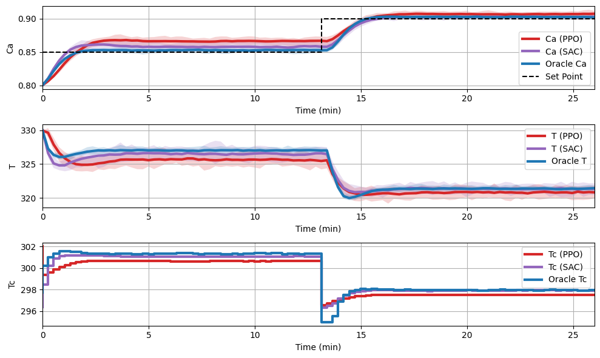
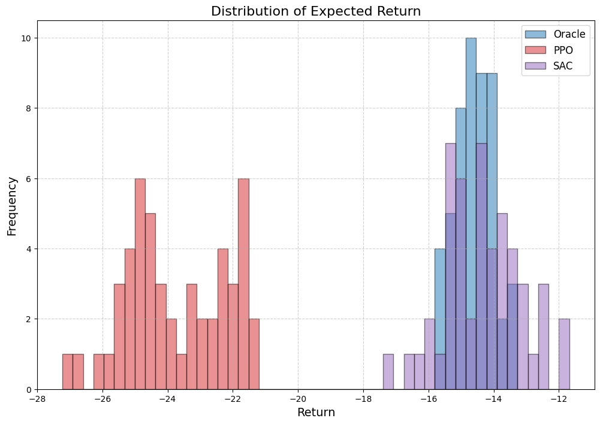

<script type="text/javascript"
  src="https://cdnjs.cloudflare.com/ajax/libs/mathjax/2.7.0/MathJax.js?config=TeX-AMS_CHTML">
</script>
<script type="text/x-mathjax-config">
  MathJax.Hub.Config({
    tex2jax: {
      inlineMath: [['$','$'], ['\\(','\\)']],
      processEscapes: true},
      jax: ["input/TeX","input/MathML","input/AsciiMath","output/CommonHTML"],
      extensions: ["tex2jax.js","mml2jax.js","asciimath2jax.js","MathMenu.js","MathZoom.js","AssistiveMML.js", "[Contrib]/a11y/accessibility-menu.js"],
      TeX: {
      extensions: ["AMSmath.js","AMSsymbols.js","noErrors.js","noUndefined.js"],
      equationNumbers: {
      autoNumber: "AMS"
      }
    }
  });
</script>
This is a user guide for the policy evaluation tool in pc-gym which will walkthrough an example of how to use the policy evaluation tools available in `pc-gym`


### Plot Rollout 
The following code shows the policy and oracle comparison capability. The oracle is defined as a NMPC with perfect model (oracle uses ocp with control cost which differs from the reward function used by the RL agent) and can be sensitive to tuning of the horizon and control cost. 

```py
policies = {'PPO': PPO_policy,'SAC':SAC_policy} # Dictionary of policies to compare
evaluator,data = env.plot_rollout(policies, reps = 10, oracle=True, dist_reward=True, MPC_params={'N':15,'R':5})
```
<figure>
  
</figure>

### Reward Distribution and Reproducibility Metric
A visualisation of the reward distribution can also be shown using `dist_reward`.
<figure>
  
</figure>

The `pc-gym` can also calculate dispersion and performance metrics of the distribution of rewards to allow the user to evaluate their policy. This anaylsis follows the evaluation metric used by [Manon Flageat et al (2024)](https://arxiv.org/pdf/2312.07178.pdf). First an instance of the `reproducibility_metric` class is created with the user-selected metrics for both performance and dispersion:
```py
policy_measure = reproducibility_metric(dispersion='mad', performance='mean', scalarised_weight=2e3)
```
Then the `policy_dispersion_metric` method can be called to return a dictionary of the dispersion metrics:
```py
policy_measure.policy_dispersion_metric(data, component='r')
# which returns:
#{'oracle': {'r': array([0.38975316])},
# 'PPO': {'r': array([1.18513328])},
# 'SAC': {'r': array([0.83717672])}}
```
Then the `policy_performance_metric` and po method can be called to return a dictionary of the performance metrics:
```py
policy_measure.policy_performance_metric(data, component='r')
# which returns:
#{'oracle': {'r': array([-14.58502467])},
# 'PPO': {'r': array([-23.76918418])},
# 'SAC': {'r': array([-14.33262298])}}
```
### Matched episodes and valid trajectory data

Evaluation now uses the same reset seeds for each policy. The default base seed is `0`;
set `seed` to generate another suite or provide one explicit seed per repetition:

```py
evaluator, data = env.get_rollouts(policies, reps=10, seeds=list(range(100, 110)))
```

Only configured randomness varies. Deterministic nominal tasks repeat the same scenario.
A stochastic custom policy can implement `reset(seed=...)` to reproduce its own randomness.
SB3 recurrent policies receive fresh recurrent state and episode-start flags at every reset.

Each policy's dictionary contains:

| Entry | Shape | Meaning |
|---|---|---|
| `x` | `(observation_size, N+1, reps)` | Full unmasked measurements in physical units, including setpoints, disturbances, uncertainty and time entries |
| `u` | `(control_count, N, reps)` | Applied physical controls, including accumulated/saturated delta inputs |
| `r` | `(1, N+1, reps)` | Zero reset reward followed by transition rewards, including the terminal reward |
| `g` | `(constraint_count, N+1, 1, reps)` | Signed residuals, when constraints are configured; positive means violated |
| `lengths` | `(reps,)` | Number of completed transitions |
| `state_mask` | `(N+1, reps)` | Valid state/reward/constraint columns, including reset and the terminal observation |
| `transition_mask` | `(N, reps)` | Valid action columns |
| `terminated`, `truncated` | `(reps,)` | Final Gymnasium flags |
| `seeds` | `(reps,)` | The reset seed used for each episode |

The evaluator stops at either done flag. Unused columns are `NaN`; zero-filled padding from
older releases must not be interpreted as observed data. The direct `rollout(policy)` method
still returns four arrays; `return_metadata=True` appends the validity dictionary. For example:

```py
from pcgym.evaluation_metrics import episode_returns

returns = episode_returns(data['PPO'])  # shape (1, reps); excludes reset and padding
last_state = data['PPO']['x'][:, data['PPO']['lengths'][0], 0]
```

Metrics and plots exclude invalid columns. Reward metrics and histograms now use one
undiscounted return per episode, rather than individual time-step rewards. State and action
metrics retain their time axes and aggregate available repetitions. After every episode has
ended, the metric is `NaN`, not zero. Constraint metrics use the greatest positive residual
across constraints; constraint plots show the median and range of positive violations so
feasible slack cannot cancel a violation. Short schedules hold their final value.

Batch and custom objectives use rewards returned by `step`, preserving final-state rewards.
Oracle comparisons currently support nominal tracking with absolute inputs, fixed schedules
and no early constraint termination. Batch/custom rewards, noise, uncertainty and delta inputs
raise a clear error when `oracle=True`: the present MPC implementation cannot provide a
matched comparison for these cases. The deterministic oracle is solved once for all repetitions;
its `x` retains the legacy model-state-only layout and its `u` may include disturbance channels.
Oracle rewards use a separate environment, leaving the evaluator's current episode intact.
