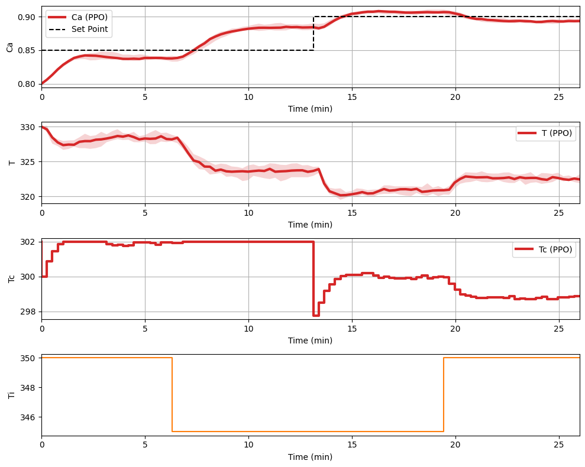

This guide adds a scheduled inlet-temperature disturbance to the CSTR environment from the
[training guide](training.md).

### Disturbance Definition

The `disturbances` dictionary maps model disturbance names to nonempty sequences. For CSTR,
`Ti` is the inlet temperature in kelvin. These values are appended to the observation, so
their physical bounds must also be supplied.

At state `x_t`, the observation shows `d[t]`. That value is held over the next integration
interval; the resulting observation shows `d[t+1]`. The last schedule value is held when
the sequence ends. See [schedule timing](observations.md#schedule-timing) for the setpoint,
reward and MPC conventions.


```py
# Define disturbance dictionary
# N interval values; the final observed state holds the last value (350 K).
inlet_temperature = np.full(nsteps, 350.0)
inlet_temperature[nsteps // 4 : 3 * nsteps // 4] = 345.0
disturbance = {'Ti': inlet_temperature}
disturbance_space ={
  'low': np.array([320]),
  'high': np.array([350])
}
env = make_env({**env_params,'disturbance_bounds':disturbance_space, 'disturbances': disturbance})
```

### Training with a Disturbance Example
A policy is now trained on the environment with a disturbance. We use the <a href ="https://arxiv.org/abs/1707.06347"> Proximal Policy Optimization (PPO)</a> algorithm implemented by <a href="https://stable-baselines3.readthedocs.io/en/master/#">Stable Baselines 3</a>.
```py
disturbance_policy = PPO('MlpPolicy', env, verbose=1,learning_rate=0.01).learn(total_timesteps=30_000)
env.plot_rollout({'PPO': disturbance_policy}, reps=10)
```
<figure>
  
</figure>
