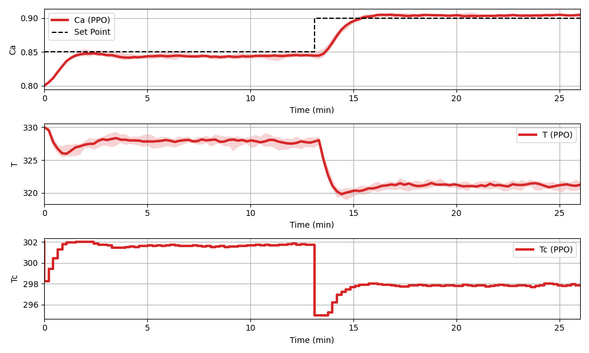

This is a user guide to setup a training algorithm using the pc-gym environment. We use  <a href="https://stable-baselines3.readthedocs.io/en/master/#">Stable Baselines 3</a> to implement the reinforcement learning algorithm  <a href ="https://arxiv.org/abs/1707.06347"> Proximal Policy Optimization (PPO)</a>.

### Environment Definition
Firstly import the pc-gym library, numpy and stable baselines 3.

```py
from pcgym import make_env
import numpy as np 
from stable_baselines3 import PPO
```
In control systems, a setpoint is the target or goal for a system's output. It's the value that the control system aims to achieve.

In this code snippet, a dictionary named `SP` is created to store the setpoints for each state. The keys in the dictionary represent the state (concentration of species A), and the values are lists that represent the setpoints for each step in the state.
```py
T = 26
nsteps = 100
# Enter required setpoints for each state.
SP = {
    'Ca': [0.85 for i in range(int(nsteps/2))] + [0.9 for i in range(int(nsteps/2))],
}

```
`SP[t]` is the target at state time `t`. Reset exposes `SP[0]`; a step returning `x_(t+1)`
uses `SP[t+1]` for both the observation and reward. The final value is held when the sequence
ends. See [schedule timing](observations.md#schedule-timing) for disturbances and the MPC oracle.

In reinforcement learning, the `action_space` and `observation_space` are two important concepts that define the range of possible actions that an agent can take and the range of possible observations that an agent can perceive, respectively.

In this code snippet, both the `action_space` and `observation_space` are defined as continuous spaces, represented by a dictionary with 'low' and 'high' keys. 
```py
# Continuous box action space
action_space = {
    'low': np.array([295]),
    'high':np.array([302]) 
}

# Continuous box observation space
observation_space = {
    'low' : np.array([0.7,300,0.8]),
    'high' : np.array([1,350,0.9])  
}
```

The `env_params` dictionary configures the Gymnasium environment created by `make_env`.

```py
r_scale ={
    'Ca': 1e3 #Reward scale for each state
}
env_params = {
    'N': nsteps, # Number of time steps
    'tsim':T, # Simulation Time
    'SP':SP, # Setpoint
    'o_space' : observation_space, # Observation space
    'a_space' : action_space, # Action space
    'x0': np.array([0.8,330,SP['Ca'][0]]), # Model states followed by the initial target
    'model': 'cstr', # Select the model
    'r_scale': r_scale, # Scale the squared tracking error in the negative reward
    'normalise_a': True, # Normalise the actions
    'normalise_o':True, # Normalise the states,
    'noise':True, # Add measurement noise; the process state remains noise-free
    'integration_method': 'casadi', # Select the integration method
    'noise_percentage':0.001 # Noise percentage
}
env = make_env(env_params)
```

`N` must be a positive integer and `tsim` finite and positive. Supply finite initial states,
one action bound per model control input, and nonempty finite schedules using valid state or
disturbance names. Normalized spaces need finite ordered bounds with positive widths.
Invalid configurations raise `ValueError` during construction.

Each action must be a finite vector with exactly `env.action_space.shape`, inside the public
action bounds. Scalars and out-of-range actions are rejected before the episode advances.
For `a_delta=True`, a valid increment is accumulated and the absolute input is clipped to
`a_space_act`; `a_0` must be a vector of the same input shape, inside those absolute bounds. Solver exceptions and invalid
solver outputs raise an error with the backend, model, step and inputs, leaving the previous
episode state intact.

See [episode endings and stochastic observations](observations.md#episode-endings-and-time-remaining)
for batch termination, time remaining, noise support and seeded uncertainty. Stop a manual
rollout on either `terminated` or `truncated` and reset before stepping again.

### Policy Training
Next the policy can be trained using the previously defined environment and the PPO algorithm from stable baselines 3.
```py
nsteps_learning = 30_000
PPO_policy = PPO('MlpPolicy', env, verbose=1,learning_rate=0.001).learn(nsteps_learning)
```

### Policy Rollout and Plotting
With the trained policy, the `plot_rollout` method can be called to rollout and plot the resulting state and control values. The method returns an instance of the evaluator class and the data used for the plots

```py
evaluator, data = env.plot_rollout({'PPO': PPO_policy}, reps = 10)
```


<figure>
  
</figure>

### Reproducible readiness experiment

The [initial experiment](../reviews/initial_training_protocol.md) fixes a common CPU budget
for PPO and SAC on four registered tasks. Run it from the repository root:

```sh
python scripts/check_training_readiness.py --output /tmp/pcgym-training
```

The [measured results](../reviews/initial_training_results.md) support first-order training with
both algorithms, CSTR with PPO, and extraction with SAC in the tested settings. Nonsmooth
control and the remaining algorithm/task combinations do not yet pass every learning criterion.

It requires Stable-Baselines3, Torch, SciPy, Matplotlib and CasADi. In the development
validation environment, use `/data1/conda/envs/python3.14/bin/python` in place of `python`.
This records 24 runs (two algorithms × four tasks × three seeds), saves the policies,
checks vectorized reset and save/load behavior, and writes episode metrics plus learning curves.
`--models first_order_system --training-seeds 0 --steps 2048` selects a smaller compatibility
check. Its smaller budget does not satisfy the full learning protocol. `--resume` retains
completed compatible runs only when the experiment settings and package versions match.

The process exits nonzero on execution/compatibility failures. A zero exit status does **not**
mean that learning succeeded: inspect `learning_pass` and the individual criteria in the
result JSON. Poor learning with a fixed budget should be investigated separately from API,
solver or physics defects. Do not silently tune the evaluation criteria after seeing results.

Every algorithm receives its own copy of policy configuration. Some SB3 algorithms modify
`policy_kwargs` in place; sharing that dictionary between SAC and PPO can break later runs.

## Compatibility checks for additional default tasks

The existing validation runner also supports nominal compatibility checks for tasks with multiple
setpoints, terminal yield or model-specific rewards:

```bash
OPENBLAS_NUM_THREADS=1 OMP_NUM_THREADS=1 MKL_NUM_THREADS=1 \
  python scripts/check_training_readiness.py --compatibility-only \
  --models batch complex_cstr disease hydraulic_tank reactor_separator_recycle \
  --output /tmp/pcgym-task-smoke
```

This mode defaults to one seed and 2,048 transitions per PPO/SAC run. It checks strict observation
containment, finite updates, terminal auto-resets and identical deterministic predictions/rollouts
after save/load. It writes resolved task configuration, package versions and results alongside the
saved policies. A pass establishes compatibility, not learning quality. The original four-task
learning protocol remains available without `--compatibility-only`.
