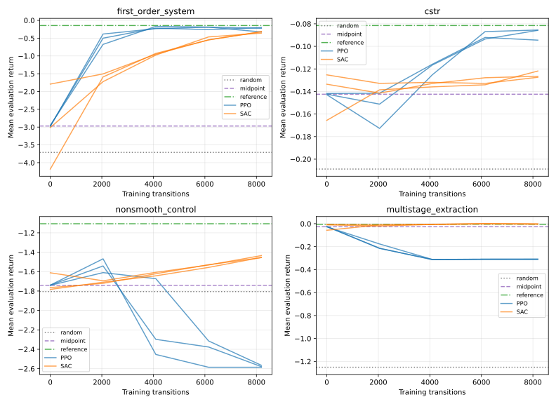

# Initial training results — 2026-10-15

All four initial CasADi tasks now run through PPO and SAC without interface or numerical
failures. **Only the first-order task passes every declared learning criterion with both
algorithms across all three seeds.** CSTR has a validated PPO recipe; extraction has a
validated SAC recipe. Nonsmooth control still needs a better training recipe.

This is evidence for the configurations below, not an unconditional endorsement of every
model, backend or optional feature. Work remains in the [repair plan](../plans/training_readiness_plan.md).
The [original all-model assessment](environment_readiness.md) remains the historical baseline.

## Experiment and classification

The [protocol](initial_training_protocol.md) was declared before training. It uses registered
defaults, normalized actions/observations, CasADi, 60-step episodes, and 8,192 transitions
per algorithm/task/seed. Simulation durations are 10, 26, 5 and 60 model time units for
first order, CSTR, nonsmooth and extraction, respectively. Training seeds are 0–2; ten
matched evaluation seeds (100–109) vary only the initial tracked state uniformly by ±5%.

There are **24 completed runs, 196,608 training transitions and 3,264 vectorized episode
resets**. All runs have finite final parameters/training diagnostics, correct terminal
observations and successful save/load. All ten evaluation episodes of every saved policy
reproduce the original returns, RMSE, final errors, lengths and bound checks exactly after
reload. There are no final evaluation solver failures or observation/action bound violations.

The table reports the number of passing training seeds. Returns are averaged across the
three seeds and ten scenarios; the RMSE range spans each seed's mean over its ten scenarios.
Rewards have different scales between tasks and should not be compared across rows for
different tasks. Larger returns are better.

| Task | Algorithm | Compatibility | Learning | Mean final return | Tracking RMSE range |
|---|---|---:|---:|---:|---:|
| `first_order_system` | PPO | 3/3 | 3/3 | -0.250658 | 0.05829–0.07376 |
| `first_order_system` | SAC | 3/3 | 3/3 | -0.331031 | 0.07235–0.07720 |
| `cstr` | PPO | 3/3 | 3/3 | -0.088592 | 0.01118–0.01178 |
| `cstr` | SAC | 3/3 | 2/3 | -0.125251 | 0.01342–0.01372 |
| `nonsmooth_control` | PPO | 3/3 | 0/3 | -2.576491 | 0.41351–0.41514 |
| `nonsmooth_control` | SAC | 3/3 | 0/3 | -1.447911 | 0.30916–0.31139 |
| `multistage_extraction` | PPO | 3/3 | 0/3 | -0.309249 | 0.07179–0.07179 |
| `multistage_extraction` | SAC | 3/3 | 3/3 | -0.002943 | 0.00516–0.00836 |

Practical recommendations for these tested settings:

- **First order:** usable for initial training with either provided recipe; all P2 learning
  criteria pass. This does not cover arbitrary parameter changes or optional backends.
- **CSTR:** use the tested PPO recipe. SAC seed 1 narrowly misses the required reference-gap
  return (`-0.127387` versus `-0.127219`) and does not improve its unusually good untrained
  return (`-0.125261`). All SAC seeds meet the absolute RMSE ceiling, but the all-seed gate fails.
- **Extraction:** use the tested SAC recipe. PPO becomes worse than its initial and midpoint
  policies; its RMSE exceeds the declared 0.025 ceiling. All three SAC seeds pass.
- **Nonsmooth:** software-compatible and demonstrably controllable, but neither recipe passes
  the learning gate. PPO becomes worse than random and midpoint controls. SAC improves both
  baselines but remains above the 0.30 RMSE ceiling. Do not label this configuration fully
  training-ready on these results.

The other 16 models have no new learning qualification in this experiment. Six still need
the P3 domain/task/geometry work, three need P4 physics/runtime repairs, five need P5 task
definitions, and the two autonomous models remain simulation-only candidates under P6.

## Baselines and learning curves

| Task | Random return | Midpoint return | Reference return |
|---|---:|---:|---:|
| First order | -3.712268 | -2.970001 | -0.144983 |
| CSTR | -0.208770 | -0.142448 | -0.081533 |
| Nonsmooth | -1.805747 | -1.740582 | -1.106728 |
| Extraction | -1.250780 | -0.026365 | -0.005053 |

The references use exact first-order inversion, CSTR steady balances with proportional
correction, second-order state feedback, and calibrated extraction flow with proportional
correction. They establish useful control authority without training. They are not claimed
to be optimal. SAC's extraction policies outperform the simple reference.



Each solid line represents one training seed, averaged over the same ten evaluation
scenarios. Intermediate points use the policy available at the sampling boundary; final
8,192-step points are taken after the last optimizer update. Every checkpoint, episode
metric, effective task configuration and package version is retained in
[the machine-readable results](initial_training_results.json).

## Evaluator repairs and independent checks

[Policy evaluation](../../src/pcgym/policy_evaluation.py) now stops at either done flag,
preserves final measurements/rewards and applied physical controls, and records explicit
lengths, validity masks and seeds. NaN padding is excluded from
[metrics](../../src/pcgym/evaluation_metrics.py) and plots. Reward statistics and histograms
use episode returns. Constraint plots cannot cancel positive violations with negative slack.
Recurrent policy state resets between episodes; batch/custom rewards are taken directly
from transitions. Invalid custom rewards fail evaluation rather than disappearing in a sum.

The oracle comparison explicitly rejects unsupported batch/custom, noisy, uncertain,
delta-action or early-termination scenarios. Nominal oracle rewards use an independent
environment, so scoring a trajectory cannot advance the live evaluator's episode.

The new [evaluation regressions](../../tests/policy_evaluation/test_evaluation_contract.py)
initially reproduced 16 failures. The completed 21-case suite also covers multiple
disturbance plots, more than five policies, constraint penalties, nonfinite rewards and
the convenience APIs. Existing delta-action tests now check actual evaluator trajectories.

Six new [independent physics checks](../../tests/models/test_initial_task_physics.py) pass:
second-order trajectories match a matrix-exponential solution at three constant inputs,
a closed adiabatic CSTR conserves chemical plus sensible energy, the registered CSTR target
has a feasible steady coolant, and closed extraction conserves solute with unequal phase
volumes. The earlier analytic first-order check also passes. These checks support the
implemented equations; they do not establish fidelity to a particular industrial plant.

The audit still completes all 58 midpoint/corner/alternating/ten-seed episodes for these
four tasks without material bound excursions. Its common probes were updated for constructor
noise validation, actual evaluator lengths and batch termination. Its exit code remains
evidence collection rather than a strict readiness gate.

## Reproduction and remaining work

Branch: `fix/training-ready-environments`, with uncommitted repairs over base
`7cf43322fe13341672164f5665703aa57e96baa5`. Runtime: Conda Python 3.14.6, NumPy 2.5.4,
Gymnasium 1.3.0, CasADi 3.7.2, SciPy 1.18.1, Torch 2.13.0, SB3 2.9.0 and do-mpc 5.1.2.
Torch uses one CPU thread. This local validation does not expand the package's formal
Python-version support declaration. JAX remains unavailable.

```sh
/data1/conda/envs/python3.14/bin/python scripts/check_training_readiness.py --output /tmp/pcgym-p2-training
/data1/conda/envs/python3.14/bin/python -m pytest -q -ra --tb=short
OPENBLAS_NUM_THREADS=1 OMP_NUM_THREADS=1 MKL_NUM_THREADS=1 /data1/conda/envs/python3.14/bin/python -m pytest -q -ra --tb=short -m slow
```

Validation: **433 standard tests pass**, with one existing coupled-oscillator skip and
one expected failure. **44 slow tests pass**, with 25 JAX-dependent skips. The crystallization
constrained-MPC regression passes; crystallization's broader physics and delta-oracle work
remains open. The slow suite uses one BLAS thread to avoid excessive native-solver threading.

Saved policies are in `/tmp/pcgym-p2-training`; the durable results and figure are linked
above. The runner can resume completed compatible runs with unchanged settings. Its shared
policy-settings bug was corrected before retrying affected runs; SAC now receives its own
settings copy, preventing contamination of subsequent PPO constructors. No learning criteria
or training budgets were changed in response to results.

P2's evaluator and initial experiment are complete, but its all-task/all-algorithm learning
gate remains open. Next, declare a separate experiment to investigate PPO saturation on
nonsmooth/extraction, reward/value scaling, rollout length and learning rate; extend the
nonsmooth SAC budget and assess CSTR SAC seed sensitivity. Retain the failed results and
unchanged criteria for comparison. Do not change model physics merely to compensate for
an unsuccessful algorithm configuration. P0 strict audit mode and P3–P7 remain in the plan.
